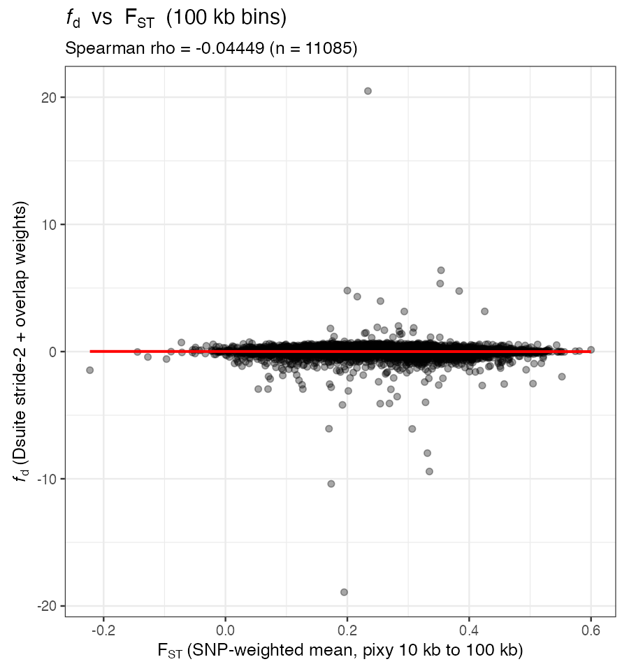
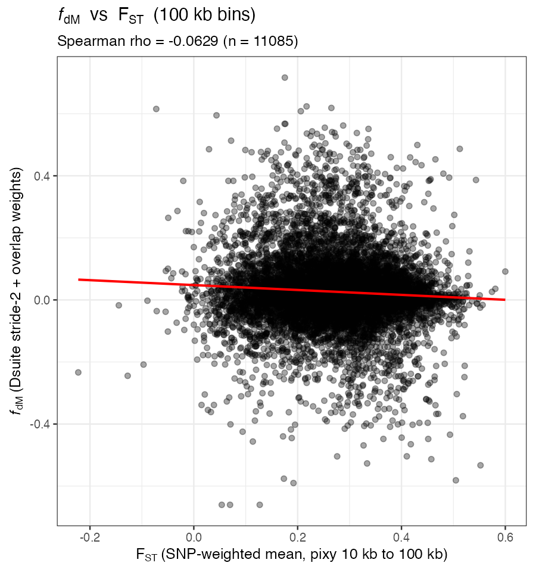
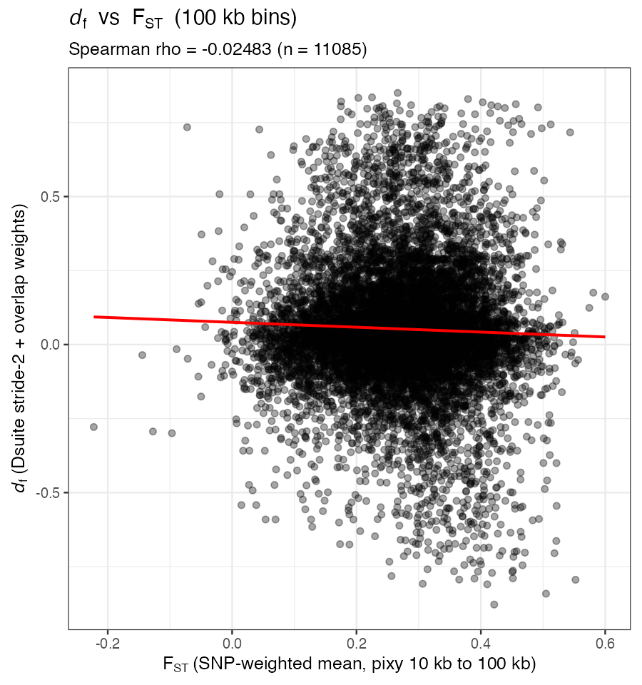
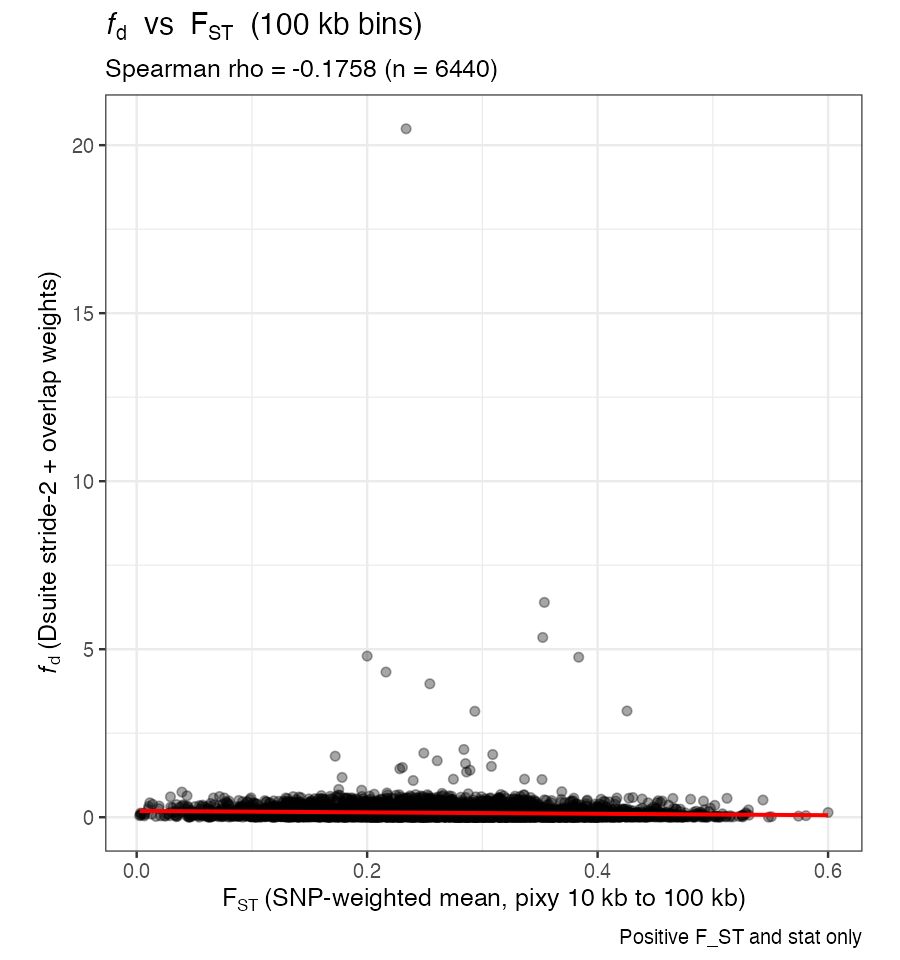
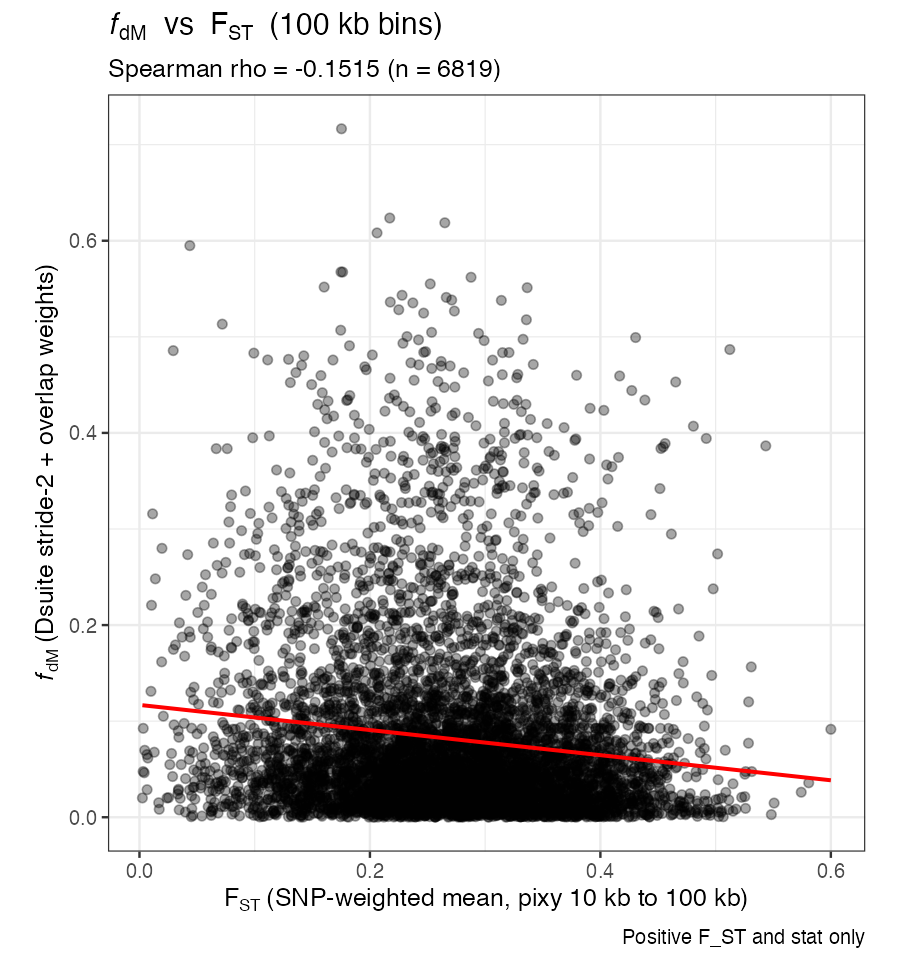
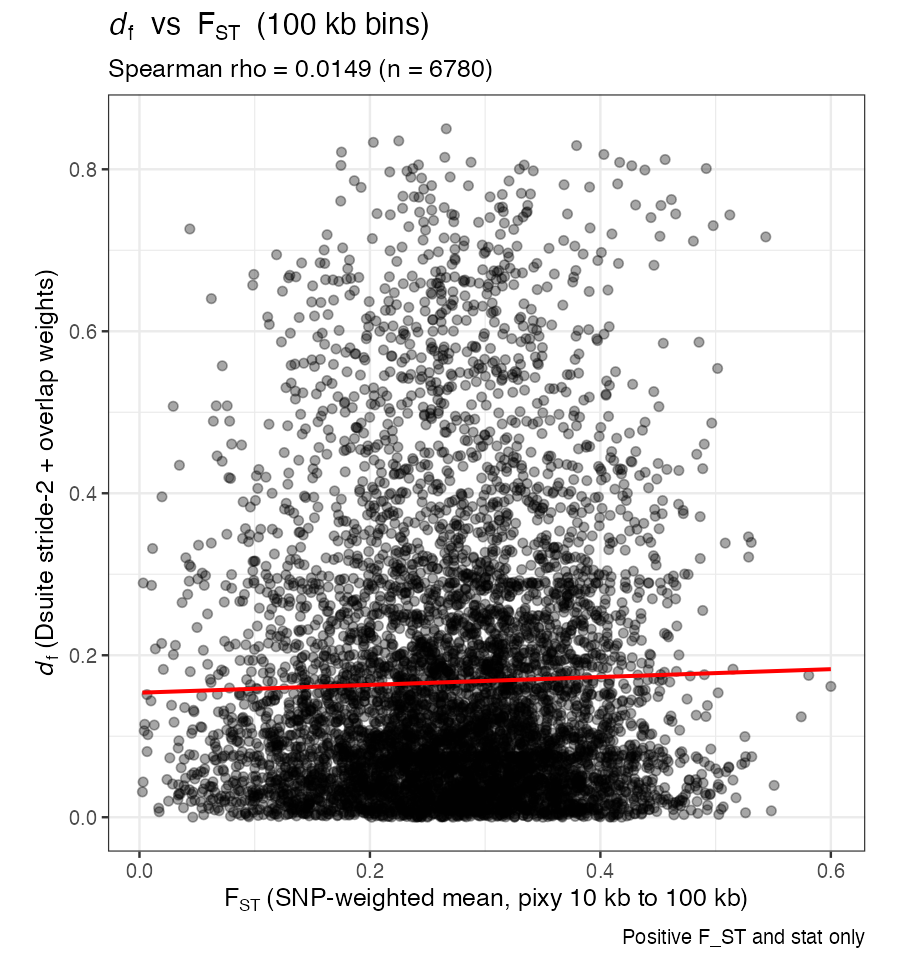
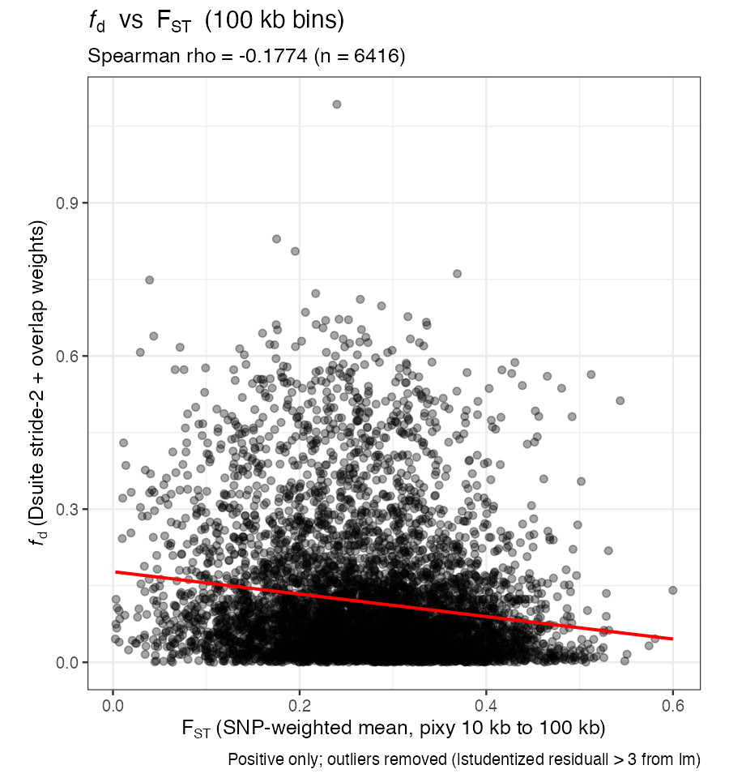
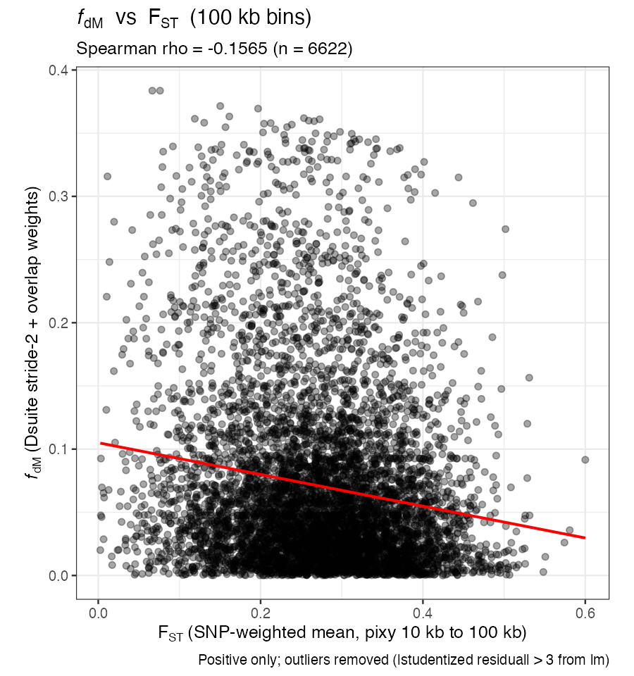
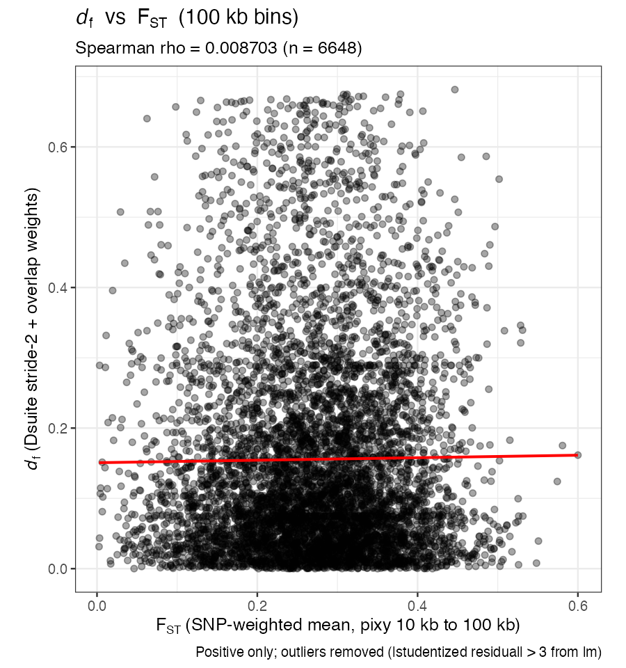

# Dsuite introgression stats vs F_ST (100 kb bins)

This report summarizes Phase 1 Spearman analyses (stride-2 thinning, overlap-weighted Dsuite windows) for **`f_d`**, **`f_dM`**, and **`d_f`** vs pixy W&C **`F_ST`**.

## Analysis modes

1. **All values** — every bin with finite F_ST and all three Dsuite statistics (includes negative values).
2. **Positive-only** — bins with **`F_ST > 0`** and the relevant introgression statistic **`> 0`** (separate filters per row in the table below).
3. **Positive-only, outliers removed** — start from the positive-only set for that statistic, then drop bins with **`|studentized residual| > 3`** from **`lm(introgression_stat ~ F_ST)`** (one linear model per statistic; outliers can differ across `f_d`, `f_dM`, and `d_f`).

Plots include a red linear trend line (`lm`, `y ~ x`). Captions on figures describe the mode.

**Re-run:** `Rscript fd_fdm_vs_fst_100kb_bins.R stride2 all|positive|positive_no_outliers`

## Spearman summary

| Mode | Statistic vs F_ST | n bins | Spearman rho | p-value (cor.test, approximate) |
|------|-------------------|-------:|-------------:|----------------------------------:|
| All values | `f_d` | 11085 | -0.044487 | 2.7917e-06 |
| All values | `f_dM` | 11085 | -0.062905 | 3.3853e-11 |
| All values | `d_f` | 11085 | -0.024832 | 8.9354e-03 |
| Positive-only | `f_d` | 6440 | -0.17577 | 7.5179e-46 |
| Positive-only | `f_dM` | 6819 | -0.15154 | 2.5881e-36 |
| Positive-only | `d_f` | 6780 | 0.014898 | 2.1998e-01 |
| Positive-only, outliers removed | `f_d` | 6416 | -0.17738 | 1.6585e-46 |
| Positive-only, outliers removed | `f_dM` | 6622 | -0.15645 | 1.4827e-37 |
| Positive-only, outliers removed | `d_f` | 6648 | 0.0087032 | 4.7801e-01 |

Note: `cor.test(..., method = "spearman")` p-values assume **independent** bins; spatial autocorrelation along the genome can make them **anti-conservative** (nominal p smaller than warranted).

## Plots

### All values

#### `f_d` vs `F_ST`

#### `f_dM` vs `F_ST`

#### `d_f` vs `F_ST`

### Positive-only

#### `f_d` vs `F_ST`

#### `f_dM` vs `F_ST`

#### `d_f` vs `F_ST`

### Positive-only, outliers removed

#### `f_d` vs `F_ST`

#### `f_dM` vs `F_ST`

#### `d_f` vs `F_ST`

## Data files (TSV)

Per mode `all`, `positive`, `positive_no_outliers`:

- `fd_fst_100kb_bins_<mode>.tsv`
- `fdm_fst_100kb_bins_<mode>.tsv`
- `df_fst_100kb_bins_<mode>.tsv`
